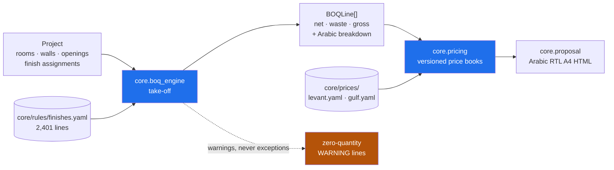

# boq-engine

**A deterministic bill-of-quantities engine for interior finishing works, with an Arabic audit trail on every number.**


You give it a project made of rooms — polygons, wall runs, clear heights, doors and
windows — and which finish system applies to which surface. It gives you back a priced
bill of quantities and a print-ready Arabic quotation, where **every quantity shows the
arithmetic that produced it**.

- **No estimation.** Restricted arithmetic over typed dataclasses, driven by a YAML rules
  file. No LLM, no randomness, no clock, no network. The same input produces the same
  bill, byte for byte.
- **No silent zeros.** When a quantity cannot be measured, the reason is written into the
  bill in Arabic. A silent `0` becomes a silent under-quote, which is the worst failure
  mode this product has.
- **Arabic is the deliverable**, not a UI skin. Item names, the audit trail, warnings and
  the printed quotation are all Arabic RTL. Identifiers and comments stay English.

---

## Why the audit trail matters

A quantity surveyor cannot defend a number they cannot trace. In an interim certificate
a wrong quantity is real money and real legal exposure. So every line carries its inputs,
how each input was derived, the convention applied, the formula, the formula with the
numbers substituted, and then net → waste → gross.

This is **real output** from [`examples/demo.py`](examples/demo.py) — a plain 5.00 × 4.00 m
salon, 3.00 m clear height, one door and one window:

```
[TIL-CER-FLR] توريد وتركيب سيراميك أرضيات
  net 20.2 m2  ->  gross 22.22 m2
  --- الاحتساب ---
  القاعدة المعتمدة: «ceramic_tile_floor» من ملف قواعد التشطيبات — حصر حسابي بحت، لا تقدير ولا نموذج لغوي.
  المُدخلات وكيف اشتُقّ كل رقم منها:
    • مساحة الأرضية = مساحة مضلع الأرضية بطريقة «رباط الحذاء» من 4 نقطة مساحية = 20.00 م٢   [floor_area]
    • خصومات مساحية مُدخلة (≥ حدّ الخصم) = 0.00 م٢   [manual_deduct_area]
    • شريط البلاط داخل فتحات الأبواب = مجموع عروض الأبواب 1.00 م × عمق المرتد 0.20 م = 0.20 م٢   [door_reveal_strip]
  المعادلة: floor_area - manual_deduct_area + door_reveal_strip
  بالأرقام: (20.00 - 0.00) + 0.20 = 20.20
  الصافي = 20.20 م٢ — وهي الكمية المدفوعة في المستخلص.
  الهدر 10%: 20.20 × (1 + 0.10) = 22.22 م٢؛ مقدار الهدر = 2.02 م٢.
  الإجمالي = 22.22 م٢ — الدفع في المستخلص على الصافي لا على الإجمالي، وإلا دُفع الهدر مرتين.
  التقريب: خانتان عشريتان، مرة واحدة في نهاية الحساب فقط — لم تُقرَّب أي قيمة وسيطة.
```

The wall-paint line in the same run shows the deduction convention doing real work:
gross wall area `18.00 × 3.00 = 54.00 m²`, minus a door and a window that each clear the
`0.50 m²` deduction threshold (`2.10 + 1.68 = 3.78 m²`), for a net of `50.22 m²`.

---

## Architecture



The `api/` layer is deliberately thin: **it computes nothing.** Quantities come from
`core.boq_engine`, rates from `core.pricing`, documents from `core.proposal`. All the API
adds is persistence, Arabic-language failure, and surfacing uncertainty.

---

## Verified numbers

Measured 2026-08 on this tree.

| | |
|---|---|
| Core engine (`core/`) | 6,945 LOC Python (stdlib + PyYAML only) |
| HTTP layer (`api/`) | 1,092 LOC — computes nothing, delegates to core |
| Domain rules | 2,401 lines of YAML (`finishes.yaml`) |
| Price books | Levant + Gulf, versioned, 883 lines |
| Web client | 7,438 LOC — React 19 · TypeScript · Vite · Tailwind 4 |
| Tests | **34 / 34 passing** — 997 LOC, each golden case hand-calculated (0.53 s) |
| HTTP surface | 13 endpoints |
| Runtime deps | 2 (`fastapi`, `pyyaml`) for the API; core needs only PyYAML |

---

## Key engineering decisions

**Rounding happens once, at the very end.** `net_qty` is the raw formula result;
`gross_qty` is `net_qty × (1 + waste_pct)`. Both round to 2 dp *only when the line is
written*. Every value handed from one line to another — grout copying its tile item,
plaster subtracting a cladding item — travels at full precision. Rounding an intermediate
is how a 200-line villa quietly drifts by a square metre.

**Warnings never crash.** An unknown rule key, a space with no polygon, an undeclared
spec parameter — each skips that one finish and leaves a zero-quantity WARNING line
saying so in Arabic. A take-off that dies on room 14 of 30 is useless; a take-off with a
visible hole in it is honest.

**Overrides are never silent.** Scope resolves narrowest-first —
`"<space_id>:<rule_key>"` → `"<rule_key>"` → `"<space_id>:*"` → `"*"` — and every applied
*or rejected* override is written into the breakdown of each line it touched.

**Percentages are never silently reinterpreted.** Ratios are decimal fractions. A value
greater than 1 is read as a percentage and divided by 100 **with an explicit warning**.
No financial number changes quietly.

**A placeholder price book cannot produce a sendable quote.** Unpriced items return HTTP
`200` with full numbers *and* a `blocked_reason_ar`; the generated HTML is stamped DRAFT.
You get to see the arithmetic without being able to claim it is final.

**Stale writes are rejected, not merged.** `PUT` accepts the `updated_at` the client
believes it is editing; if it no longer matches, the save returns `409`. The alternative
is a window holding an old document erasing everything saved after it.

**The safe evaluator is adversarially tested** — no attribute access, no dunders, no
calls, no imports. Formulas live in YAML, so the formula language is an attack surface
and is treated as one.

---

## Test rigor

The tests are deliberately not smoke tests. Each golden case is worked out **by hand in
its own docstring** — dimensions, deduction, formula, waste — so a quantity surveyor can
redo the arithmetic on paper and either agree with the engine or prove it wrong:

```
formula: floor_area − manual_deduct_area + door_reveal_strip
  floor_area         = shoelace(5×4)              = 20.00 m²
  manual_deduct_area = deduct_areas_m2 is empty   =  0.00 m²
  door_reveal_strip  = 1.00 m × 0.20 m            =  0.20 m²
  net   = 20.00 − 0.00 + 0.20                     = 20.20 m²
  gross = 20.20 × 1.10                            = 22.22 m²
```

Coverage: geometry (shoelace, L-shaped rooms, net wall area) · one hand-calculated golden
case per finish family · the per-opening deduction threshold above and below the limit ·
skirting (doors come off the run, windows do not) · waste and overrides landing in the
audit trail · adversarial safe-evaluator tests · versioned pricing and the placeholder
gate · validation of impossible geometry · `to_dict()` → `from_dict()` round-trip.

---

## Honest limitations

- **Not validated against real projects yet.** The conventions encoded here — deduction
  thresholds, reveal treatment, waste percentages — are professional conventions, not a
  binding standard. Until they are checked against real post-execution BOQs, this remains
  polished guesswork. That is why the project is paused rather than shipped, and why
  [`docs/intake_past_projects_ar.md`](docs/intake_past_projects_ar.md) asks an architect
  for 50–100 past projects with drawings, final BOQs *and* actual dated prices.
- **Price books are placeholders.** The Levant and Gulf books carry structure and units,
  not surveyed market rates. The engine knows this and refuses to call such a quote
  sendable — but it means no number here is a market number.
- **Single-file SQLite, no ORM, no auth, no multi-user.** One row per project, whole
  document in a JSON column. Fine for one office; not a hosted product.
- **No deployment.** No Dockerfile, no CI. It runs locally on uvicorn.
- **Coverage is on `core/`.** The API layer and the React client have no automated tests.

---

## Run it

```bash
pip install -r api/requirements.txt

python -m pytest tests/ -q          # 34/34
python examples/demo.py             # worked example with the Arabic audit trail

uvicorn api.main:app --reload --port 8100
#   docs   http://127.0.0.1:8100/docs
#   health http://127.0.0.1:8100/api/health
```

Interactive Arabic API documentation lives in [`api/README.md`](api/README.md).

---

## License

MIT — see [LICENSE](LICENSE).

*Published from local development (2026); the original working history is retained
privately.*
